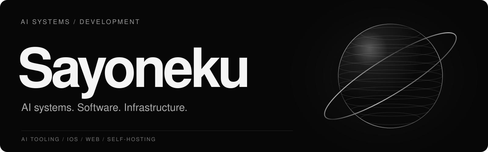
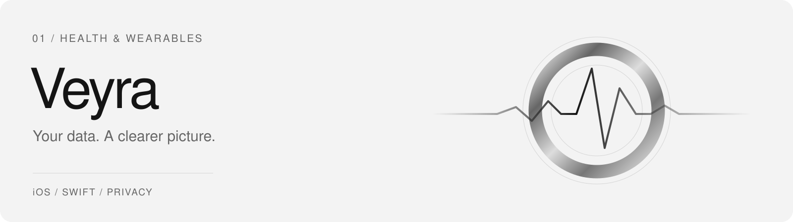
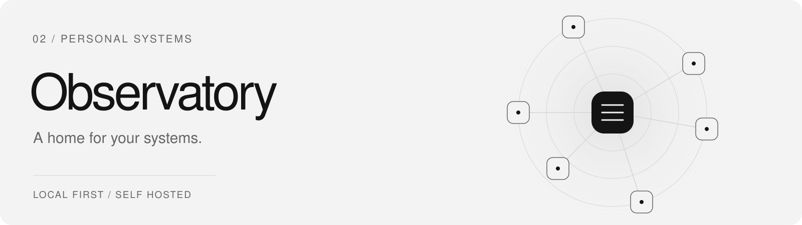

<!-- Sayoneku / GitHub profile -->

  

  <a href="https://sayoneku.com">Website</a> &nbsp;·&nbsp;
  <a href="https://github.com/Sayoneku/Projects">Public code</a> &nbsp;·&nbsp;
  <a href="https://github.com/Sayoneku?tab=repositories">Repositories</a>

**IT student and independent developer.** My primary interest is AI systems: how language models handle context, invoke tools and interact with external software. I also build iOS applications, work with structured data and maintain self-hosted services.

---

### 01 / TECHNICAL FOCUS

| Area | What I work with |
| :-- | :-- |
| **AI systems & tooling** | LLM behaviour, context management, function/tool calling, MCP, agent workflows and API integrations. |
| **Infrastructure** | Linux, Docker, self-hosting, networking, service configuration, HTTPS and troubleshooting. |
| **Software & data** | Swift/iOS, Python, JavaScript/TypeScript, data ingestion, validation and reconciliation. |

&nbsp;
&nbsp;
&nbsp;
&nbsp;
&nbsp;
&nbsp;
&nbsp;

---

### 02 / SELECTED PROJECTS

<picture>
<source media="(prefers-color-scheme: dark)" srcset="./assets/portfolio/veyra-dark.svg" />

</picture>

**Veyra** &nbsp;·&nbsp; `Swift` `iOS` `Wearable data` &nbsp;·&nbsp; *In development*

Private iOS health application. Work includes importing and deduplicating wearable measurements, reconciling conflicting sleep records and calculating sleep and activity metrics with a self-hosted backend.

<picture>
<source media="(prefers-color-scheme: dark)" srcset="./assets/portfolio/observatory-dark.svg" />

</picture>

**Observatory** &nbsp;·&nbsp; `Web` `Monitoring` `Self-hosting` &nbsp;·&nbsp; *In development*

Local web dashboard project for viewing service status and system information across personal infrastructure. Initially designed to run on a Windows PC.

Project artwork is conceptual. These are development projects, not public releases.

---

### 03 / PUBLIC CODE

**[ISS Live Tracker](https://github.com/Sayoneku/Projects/blob/main/iss_tracker.html)** — Interactive browser-based tracker with a custom map interface.

**[Projects](https://github.com/Sayoneku/Projects)** — Source repository for public web experiments.

---

### 04 / CONTRIBUTIONS

Show contribution graph

<picture>
<source media="(prefers-color-scheme: dark)" srcset="https://raw.githubusercontent.com/Sayoneku/Sayoneku/output/github-contribution-grid-snake-dark.svg" />

</picture>

Generated from public GitHub contributions by <a href="https://github.com/Sayoneku/Sayoneku/blob/main/.github/workflows/snake.yml">GitHub Actions</a>.

